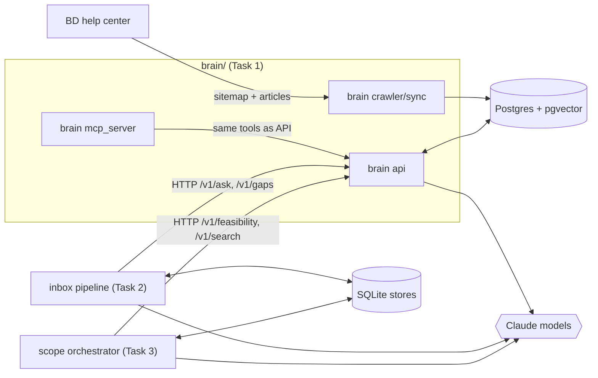

# Design

Read time: about 10 minutes. Numbers marked `TBD (run make eval)` are not measured yet.
We do not guess them.

## 1. The problem, in our words

Software got cheap. The price of building a feature fell by roughly 90%, and Claude writes
working code in minutes. So code is no longer the bottleneck for a consultancy that builds on
Brilliant Directories (BD).

Three things are still slow, and all three are about product knowledge, not code:

1. **Knowing the product.** BD has a large help center. A client asks "can members pay
   monthly?" The honest answer is often "yes, it is a setting", and nobody should write code
   for it. Finding that means an expert searching articles by hand.
2. **The inbox.** Most client emails repeat a small set of kinds of question. Each one still
   needs a careful, correct reply, and a wrong promise (a refund, a date) costs real money.
3. **Scoping.** After a discovery call, a senior person turns the conversation into
   requirements, an estimate and a proposal. It is slow, and it decides the price.

So we built one shared brain that knows the product, and two agents that use it.

## 2. What we built, and why

### 2.1 Answers labelled by how the thing is solved (the unwritten need)

Clients do not ask "what does article 12000047895 say". They ask "how do I get X", and what
they really need to know is **how much work X is**. Every Brain answer carries one label:

| Label | Means | What the answer adds |
|---|---|---|
| Setting | Already in the product, just switch it on | A "where to click" path, e.g. `Settings > Advanced Settings > Members > Suspend Past Due` |
| Add-on | Exists, but as a paid add-on | Which add-on, where to enable it |
| Widget customization | Possible by editing a default widget | A warning: **customizing a default widget stops it receiving updates** |
| Custom dev | Not in the product; needs code | Goes to Scope as a real line item |
| Unknown | Brain is not sure | Says so and opens an expert task |

Why: this label is the bridge between support and sales. "Setting" is a 2-minute reply.
"Custom dev" is a paid project. Scope calls the same logic (`POST /v1/feasibility`) so the
estimate never charges for something the product already does.

### 2.2 Changelog-aware answers

BD changes. An answer that was right last year can be wrong now. The crawler stores each
article's `lastmod`, a nightly sync (`brain.scheduler`, 03:00 by default) picks up changes,
and changelog articles get a retrieval boost so "new" behaviour beats "old". The sync refuses
to delete more than 20% of articles in one run, because a broken sitemap should not wipe
the brain.

### 2.3 Expert queue

When Brain cannot answer with confidence, it says "I don't know" and opens a gap
(`POST /v1/gaps`). An expert answers once. That answer becomes a curated `expert` chunk and is
used immediately by every future question. Why: abstaining is cheaper than a wrong answer,
and each gap closes a hole for good.

### 2.4 Inbox: per-kind trust ladder

A "kind" of email is intent + customer type + risk class. Each kind earns trust on its own,
because being good at "password reset" says nothing about "refund request".

- **Shadow:** the first 5 counted outcomes of a kind only draft.
- **Draft:** a human edits and sends. We record how much they changed.
- **Auto:** only after 20 sends in a row went out unchanged **and** the Wilson lower bound of
  the unchanged rate over the last 30 is at least 0.9.
- **Never auto:** refunds, commitments (dates, prices, promises) and legal. A human always sends.
- **Circuit breaker:** 2 material edits in the last 10 sends of a kind drop it back to draft.

"Unchanged" is strict. All three must hold: edit distance below 2%, embedding cosine above
0.97, and a judge model says there is no material change. Why three: edit distance misses a
changed number, cosine misses a flipped "not", the judge can be fooled. Together they are hard
to fool. All thresholds live in one file so a reviewer can audit them.

### 2.5 Inbox: the learning loop

Every sent email teaches the agent in two ways:

1. **Few-shot memory.** The 3 most similar past (email, sent reply) pairs go into the prompt.
2. **Versioned playbook.** When a human edits a draft, a reflector proposes at most 2 short
   rules ("always link the billing article"). A curator merges duplicates and prunes rules
   that hurt more than help. Every playbook change is a new version that must pass a small
   regression eval before promotion, and any version can be rolled back.

Why not fine-tuning: see section 3.

### 2.6 Scope: agent team with a scope diff

A transcript goes through an orchestrator that runs specialist agents: requirements
extraction, feasibility (via Brain), estimation, review, and a reconciler that resolves
disagreements. The output is a requirements list, an estimate per item and a proposal.

When a second meeting happens, Scope produces a **scope diff**: what was added, removed or
changed since the last version, written as change requests with their cost impact. Why: scope
creep is where fixed-price projects lose money, and a diff makes it visible to the client.

## 3. What we dropped, and why

| Dropped | Why | What we do instead |
|---|---|---|
| Live Gmail / IMAP sync | OAuth review, security risk and flaky tests for little demo value | Seeded inbox (`make seed`), same pipeline |
| Real audio transcription | Speech-to-text is a solved, separate problem | Scope takes a text transcript |
| CRM push | Each CRM is different; no client needs it yet | Proposal is exported as text |
| PDF / e-sign styling | Formatting work, not product knowledge | Plain proposal document |
| Multi-tenant auth | One consultancy, one product for now | One API key (`BRAIN_API_KEY`) |
| Fine-tuning | Slow to iterate, hard to roll back, needs data we do not have | Few-shot memory + versioned playbook, rollback in one step |

## 4. How the three tasks connect

Tasks 2 and 3 talk to Task 1 only over HTTP (`docs/contracts/brain-api.md`). That lets each
task be built, tested and replaced on its own.

## 5. Model choices

Prices are USD per million tokens (input / output), as configured for this project.

| Model | Price in / out | Used for | Why (to be confirmed by eval tables) |
|---|---|---|---|
| `claude-haiku-5-5` | 0.10 / 0.50 | Inbox screening, email classification, screenshot descriptions, cheap judges | High volume, short outputs. TBD (run make eval) |
| `claude-sonnet-5-5` | 2 / 10 | Brain answers, inbox drafts, scope proposal text | Quality matters and the client reads it. TBD (run make eval) |
| `claude-opus-5-5` | 4 / 20 | Scope requirements, estimation, review, reconciler; the eval judge | Few calls, high stakes, errors cost money. TBD (run make eval) |

Each choice must be backed by `docs/EVALS.md`: the same cases run on each candidate model,
and we pick the cheapest model whose pass rate interval overlaps the best one. Until those
tables are filled, the table above is a hypothesis, not a result.

### 5.1 Fallback providers

Claude is the primary model everywhere. Google Gemini (`gemini-2.5-flash`) and NVIDIA
(`meta/llama-3.3-70b-instruct` on build.nvidia.com) are configured as fallbacks, tried in
`LLM_FALLBACK_ORDER`, through their OpenAI-compatible Chat Completions endpoints, with no extra SDKs.

- **When.** A fallback runs only when Claude is unavailable after its own retries (rate limit,
  5xx, network), or when no Anthropic key is set. It never runs after a refusal, a bad request
  or a schema failure, so a fallback can never route around a refusal.
- **Structured output.** The JSON schema goes in `response_format`, and the result is checked
  again locally with pydantic or zod. Providers that reject `json_schema` get one retry in
  `json_object` mode.
- **Brain citations.** The Citations API is Claude-only. On fallback the model returns
  `{document_index, cited_text}` pairs, and any quote that is not a literal substring of its
  document is dropped.
- **Inbox safety.** A draft written by a fallback model is never auto-sent; the trust ladder
  drops it to assist.
- **Logging.** Every call logs the provider's model name, so the audit trail shows which
  provider answered. Default prices are gemini-2.5-flash at 0.30 / 2.50 and NVIDIA at 0 (free
  tier). Overrides are set per app: `GEMINI_INPUT_PRICE_PER_MTOK` and the related variables in
  brain, `SCOPE_GEMINI_PRICE` and `SCOPE_NVIDIA_PRICE` in scope.

## 6. What breaks (honest list)

- **Help-center layout changes** break the crawler's HTML parsing. The 20% removal guard stops
  a data wipe, but new articles will be missed until the parser is fixed.
- **Screenshots** are described by a small model. A wrong description becomes a wrong citation.
- **The label is hardest at the edges.** "Widget customization" vs "Custom dev" is a judgement
  call even for experts. Accuracy per label: TBD (run make eval).
- **Without `VOYAGE_API_KEY`** Brain uses a local embedder. Retrieval quality drops by
  TBD (run make eval).
- **Mock runs measure nothing.** Without `ANTHROPIC_API_KEY` evals run on canned responses.
  The report says so in a banner; do not quote those numbers.
- **SQLite** is one writer at a time. Fine for one consultancy, not for a team of 50.
- **Estimates** lean on a few gold examples (`scope/data/gold/`). New project types will be
  estimated badly until we add examples.
- **Docker** setup was written without Docker available on the build machine. It is
  schema-checked, not run.
- **Auto-send is a trust bet.** The ladder makes it slow to earn and fast to lose, but a
  20-send streak is still a small sample.

## 7. What we would build next

1. Live inbox sync (Gmail first), behind the same pipeline and trust ladder.
2. Per-label accuracy dashboard from eval rows, so we see drift week by week.
3. An "estimate vs actual" loop: feed real project hours back into Scope.
4. Expert queue in Slack, so experts answer where they already are.
5. Proposal PDF and e-sign, once the content is trusted.
